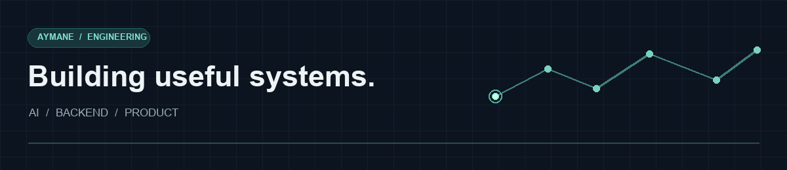

# Aymane Ait Belarbi

**AI & Python engineer** building LLM applications, backend systems, and products people can use.

I work across the stack—from PostgreSQL and APIs to user interfaces—with a focus on retrieval, agents, evaluation, and reliable production workflows.

[LinkedIn](https://www.linkedin.com/in/aymane-aitbelarbi/) &nbsp;·&nbsp; [Email](mailto:aymanesaid76@gmail.com) &nbsp;·&nbsp; Morocco · Open to remote and international roles

---

## Selected work

### [ClaimCheck ↗](https://github.com/AymaneBelarbi/ClaimCheck)
**Document AI · RAG · Evaluation**

An insurance-claim intake prototype combining document extraction, policy-version-aware retrieval, and an MCP-based adjuster agent. Includes a reproducible demo, stage-level evaluations, and a documented agent-faithfulness failure.

`Python` `FastAPI` `PostgreSQL` `pgvector` `Docker` `MCP`

### [Construction RAG ↗](https://github.com/AymaneBelarbi/construction-rag)
**Retrieval · Evidence · Deterministic checks**

A question-answering prototype for construction records. Hybrid search, structured queries, calculations, and evidence checks help answer questions over related project documents. The repository documents evaluation results and system limits.

`Python` `PostgreSQL` `pgvector` `Hybrid search`

### [ReelRecs ↗](https://github.com/AymaneBelarbi/reelrecs)
**Search · Ranking · Cited answers**

A movie-recommendation chatbot exploring hybrid retrieval, reciprocal rank fusion, reranking, and cited answers. An engineering case study with offline tests; a live end-to-end evaluation is still pending.

`JavaScript` `Node.js` `Supabase` `PostgreSQL`

---

## Beyond the repositories

**[Forma](https://trainwithforma.app)** — a fitness application built end to end.

**[T3lem Code](https://t3lemcode.com)** — a hands-on coding education project.

## Tools & approach

Python · FastAPI · TypeScript · React · Node.js · PostgreSQL · Supabase · Docker · REST APIs · LLM integrations

I care about clear failure handling, security boundaries, useful evaluations, and software that's practical to operate.

---

Bachelor of Engineering in Software Engineering, Sichuan University. I work in English and French, speak Arabic natively, and have studied Mandarin to HSK 4.
