<picture>
  <source media="(prefers-color-scheme: dark)" srcset="assets/name-dark.svg">
  
</picture>

AI and Python engineer. I build LLM applications, backend systems, and products people can use.

I work across the stack, from PostgreSQL and APIs to user interfaces, with a focus on retrieval, agents, evaluation, and reliable production workflows.

Based in Morocco and open to remote and international roles. Reach me on [LinkedIn](https://www.linkedin.com/in/aymane-aitbelarbi/) or by [email](mailto:aymanesaid76@gmail.com).

## Selected work

### [ClaimCheck](https://github.com/AymaneBelarbi/ClaimCheck)

An insurance-claim intake prototype combining document extraction, policy-version-aware retrieval, and an MCP-based adjuster agent. Includes a reproducible demo, stage-level evaluations, and a documented agent-faithfulness failure.

Built with Python, FastAPI, PostgreSQL, pgvector, Docker, and MCP.

### [Construction RAG](https://github.com/AymaneBelarbi/construction-rag)

A question-answering prototype for construction records. Hybrid search, structured queries, calculations, and evidence checks help answer questions over related project documents. The repository documents evaluation results and system limits.

Built with Python, PostgreSQL, and pgvector.

### [ReelRecs](https://github.com/AymaneBelarbi/reelrecs)

A movie-recommendation chatbot exploring hybrid retrieval, reciprocal rank fusion, reranking, and cited answers. An engineering case study with offline tests; a live end-to-end evaluation is still pending.

Built with JavaScript, Node.js, Supabase, and PostgreSQL.

## Beyond the repositories

[Forma](https://trainwithforma.app) is a fitness application I built end to end. [T3lem Code](https://t3lemcode.com) is a hands-on coding education project.

## How I work

I care about clear failure handling, security boundaries, useful evaluations, and software that's practical to operate. Day to day that means Python, FastAPI, TypeScript, React, Node.js, PostgreSQL, Supabase, Docker, REST APIs, LangChain, LangSmith, and LLM integrations.

Bachelor of Engineering in Software Engineering, Sichuan University. I work in English and French, speak Arabic natively, and have studied Mandarin to HSK 4.
